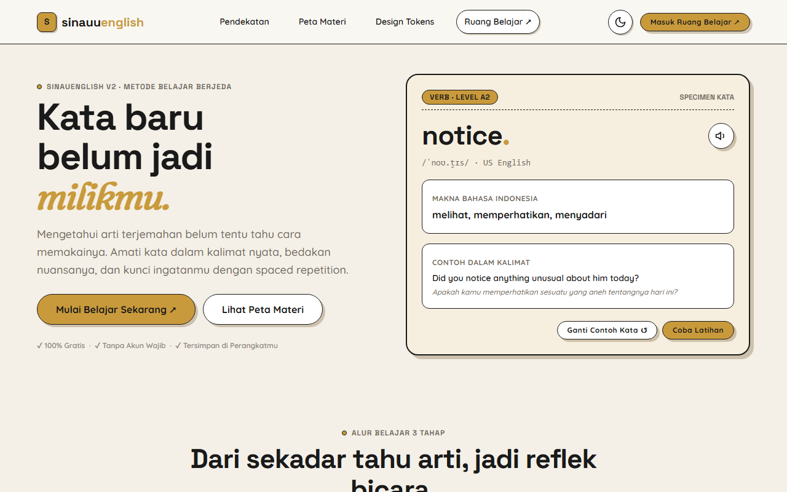
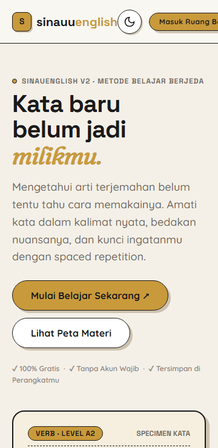

# SINAUENGLISH V2 — React Motion & Google Sheets Edition

Website belajar bahasa Inggris modern bergaya **Warm Editorial Neobrutalism** (terinspirasi dari bahasa visual [themainideas.com](https://themainideas.com/home)), dirancang khusus untuk pelajar Indonesia dari level pemula hingga menengah atas (CEFR A1–B2).

100% bebas biaya langganan, dibangun menggunakan **React JS + Vite**, CSS bertingkat (`@layer`), animasi performan (GSAP, Lenis, Framer Motion), dan backend serverless **Google Apps Script + Google Spreadsheet** untuk penyimpanan akun dan progres belajar secara terpusat tanpa database berbayar.

---

## 🚀 Arsitektur Teknologi

- **Frontend:** React 19 + React Router (JavaScript ESM + JSX)
- **Styling:** CSS Murni dengan CSS Modules + `@layer reset, tokens, base, components, utilities;` (fluid `clamp()`, container queries, `:has()`, `@property`, `color-mix()`)
- **Motion Engine:** GSAP + ScrollTrigger, Lenis Smooth Scroll, Framer Motion (lengkap dengan kepatuhan `prefers-reduced-motion`)
- **Backend:** Google Apps Script Web App (`backend/Code.gs`)
- **Database:** Private Google Spreadsheet (5 tab: `Users`, `Sessions`, `Progress`, `QuizAttempts`, `Settings`)
- **Keamanan:** Password hashing (salt acak + 5.000 iterasi SHA-256), session token di `sessionStorage` (tanpa data sensitif di `localStorage`/`IndexedDB`)
- **Mitigasi Kuota:** Client-side batch debouncing (`useProgressSync`) untuk menghemat batas eksekusi Google Cloud

---

## 📸 Tampilan Visual

| Resolusi Desktop (1280px) | Resolusi Mobile (360px) |
|---|---|
|  |  |

---

## 🌟 Fitur & Paritas 100% dari Versi 1

1. **Corpus Kosakata Oxford 3000 Lengkap:**
   - **2.971 headwords unik** (A1: 892, A2: 792, B1: 689, B2: 597, UNCLASSIFIED: 1) tanpa ada kata yang hilang.
   - 1.144 record kurasi editorial dengan makna bahasa Indonesia, fonetik IPA, dan contoh kalimat bilingual.
2. **Kurikulum Grammar Komprehensif:**
   - 19 topik materi terstruktur dari level A1 hingga B2.
   - Penjelasan konsep, rumus/pattern, contoh kalimat, dan panduan kesalahan umum (*common mistakes*).
   - Bank 57 soal kuis tervalidasi dengan pencatatan hasil ke Google Spreadsheet.
3. **Metode Belajar 3 Tahap (Fokus & Latihan):**
   - *Tahap 1: Recall Makna* (tebak arti kata sebelum membuka jawaban).
   - *Tahap 2: Pahami Konteks* (soal pilihan ganda kalimat rumpang).
   - *Tahap 3: Konfirmasi Ingatan* (kalkulasi interval SRS otomatis & batch sync).
4. **Sistem Spaced Repetition (SRS) & Mistake Review:**
   - Pengulangan otomatis pada interval adaptif: `[1, 3, 8, 16, 30]` hari.
   - Jurnal kesalahan (*Mistake Journal*) untuk meninjau kembali kata-kata yang pernah keliru.
5. **HABIT Reading Library:**
   - 156 artikel bacaan berbobot (total 63.309 kata) dengan estimasi waktu baca untuk melatih kelancaran membaca.
   - 12 materi keterampilan membaca (*reading skills*) lengkap dengan pertanyaan pemahaman.
6. **Everyday Adventure Series:**
   - 8 cerita tematik (*Everyday Stories*), 4 dialog interaktif (*Everyday English*), 8 latihan mendengarkan (*Listening Lab*), dan 16 panduan pengucapan (*Pronunciation Studio*).
7. **Penyimpanan Cloud Bebas Biaya:**
   - Seluruh akun dan progres tersimpan di Google Spreadsheet privat melalui Apps Script Web App.
   - Alat sekali jalan untuk migrasi cadangan JSON lama (*Backup Importer*) ke Spreadsheet.
8. **Dukungan Dark Mode:**
   - Pilihan tema ramah mata: *Warm Parchment* (terang) dan *Warm Espresso Night* (gelap) yang sinkron otomatis antar halaman.

---

## 🎨 Panduan Kustomisasi Tema (Design System)

Seluruh token visual dipusatkan di file [`src/styles/variables.css`](src/styles/variables.css). Kamu dapat dengan mudah mengubah nuansa warna, tipografi, dan bentuk komponen:

### 1. Mengubah Palet Warna
Buka `src/styles/variables.css` dan sesuaikan variabel CSS berikut:
```css
:root {
  /* Warna Latar Belakang (Mode Terang) */
  --color-bg-base: #F4F0E8;       /* Latar kertas perkamen krem */
  --color-bg-nav: #F9F7F2;        /* Latar header & floating navbar */
  --color-bg-surface: #FFFFFF;    /* Latar permukaan kartu putih */
  --color-bg-footer: #ECE4CF;     /* Latar footer kraft paper */

  /* Warna Teks (Ink) */
  --color-text-primary: #1A1A1A;  /* Hitam arang kontras tinggi */
  --color-text-secondary: #736B61;/* Abu-abu hangat teks sekunder */

  /* Warna Aksen Khas Neobrutalisme */
  --color-accent-gold: #C99A3B;   /* Warna tombol aksi primer (CTA) */
  --color-accent-navy: #4B5E73;   /* Warna tombol & tab sekunder */
  --color-success: #5F7A4B;       /* Hijau sage kata 'Mastered' */
  --color-danger: #8C4A4E;        /* Merah bata kata 'Needs Review' */
}
```

### 2. Mengubah Tipografi
Tema menggunakan font Google Fonts gratis yang diimpor di baris teratas `src/styles/variables.css`:
```css
/* Mengganti font family */
--font-heading: "Space Grotesk", sans-serif; /* Judul & angka statistik */
--font-editorial: "Fraunces", serif;         /* Kutipan refleksi & aksen */
--font-body: "Quicksand", sans-serif;        /* Teks isi & tombol */
```

### 3. Mengatur Gaya Border & Bayangan (Neobrutalism)
```css
--color-border: #1A1A1A;                     /* Garis border tegas */
--radius-lg: 20px;                           /* Kelengkungan sudut kartu */
--radius-pill: 9999px;                       /* Bentuk kapsul tombol & badge */

/* Bayangan padat tanpa blur */
--shadow-btn: 4px 4px 0px 0px rgba(86, 52, 0, 0.25);
--shadow-card: 6px 6px 0px 0px rgba(86, 52, 0, 0.25);
```

Untuk melihat seluruh katalog komponen secara langsung, buka halaman [`design-system.html`](design-system.html) di browsermu.

---

## 🚀 Menjalankan Proyek di Komputer Lokal

### Prasyarat
- [Node.js](https://nodejs.org/) versi `>= 22.12.0`
- Git

### Langkah Instalasi
```bash
# 1. Clone repositori
git clone https://github.com/riiddev/SINAUENGLISHV2.git
cd SINAUENGLISHV2

# 2. Pasang dependensi
npm install

# 3. Jalankan server lokal untuk development
npm run dev
# Buka http://localhost:5173 di browser kamu.

# 4. Melakukan audit paritas data (verifikasi 2.971 kata)
npm run test:content

# 5. Menjalankan pengujian logika unit test
npm run test:logic

# 6. Kompilasi build untuk produksi
npm run build
```

---

## 🌐 Panduan Deployment Gratis

### Pilihan 1: GitHub Pages (Otomatis)
Template file alur kerja GitHub Actions telah disediakan di [`docs/deploy-github-pages-workflow.yml`](docs/deploy-github-pages-workflow.yml):
1. Salin template tersebut ke folder `.github/workflows/deploy.yml` di repository GitHub kamu.
2. Di GitHub repository: buka `Settings` → `Pages`.
3. Pada bagian **Build and deployment** → **Source**, pilih **GitHub Actions**.
4. Website akan otomatis ter-build dan tayang gratis di:
   `https://riiddev.github.io/SINAUENGLISHV2/`

### Pilihan 2: Vercel (Zero-Config)
File [`vercel.json`](vercel.json) sudah tersedia di root:
1. Masuk ke [vercel.com](https://vercel.com) dan klik **Add New Project**.
2. Hubungkan repositori `SINAUENGLISHV2`.
3. Vercel akan otomatis mengenali perintah build (`npm run build`) dan output directory (`dist`). Klik **Deploy**.

### Pilihan 3: Netlify
File [`netlify.toml`](netlify.toml) sudah tersedia di root:
1. Masuk ke [netlify.com](https://netlify.com) dan klik **Add new site** → **Import an existing project**.
2. Pilih repositori `SINAUENGLISHV2` dan klik **Deploy site**.

---

## 📁 Struktur Direktori
```text
SINAUENGLISHV2/
├── .github/workflows/
│   └── deploy.yml            # CI/CD otomatis ke GitHub Pages
├── data/
│   ├── oxford3000/           # Dataset Oxford 3000 (A1–B2, 2.971 headwords + overrides)
│   ├── grammar.json          # 19 topik kurikulum grammar
│   ├── habit-reading-library.json # 156 bacaan HABIT (63.309 kata)
│   ├── reading-lessons.json  # 12 materi keterampilan membaca
│   └── vocabulary.json       # 999 kata indeks awal
├── docs/
│   ├── screenshots/          # Tangkapan layar QA (360px, 768px, 1280px, tema gelap/terang)
│   ├── audit-v1.md           # Laporan inventaris & audit repo V1
│   ├── decisions.md          # Catatan keputusan arsitektural (ADR 001–005)
│   ├── design-tokens.md      # Spesifikasi lengkap token desain & CSS variables
│   ├── parity-checklist.md   # Checklist kelulusan paritas fitur 100%
│   └── qa-lighthouse-summary.json # Laporan audit performa & aksesibilitas
├── public/                   # Aset statis publik, icons, manifest
├── scripts/
│   ├── verify-v2-data.mjs    # Script audit paritas data (2.971 kata)
│   ├── qa-audit.mjs          # Script pengujian multi-resolusi & a11y
│   └── measure-perf-a11y.mjs # Pengukuran Core Web Vitals & aksesibilitas
├── src/
│   ├── lib/
│   │   ├── storage.ts        # Layanan IndexedDB + localStorage fallback
│   │   ├── mastery.ts        # Algoritma Spaced Repetition (SRS) & status kata
│   │   ├── backup.ts         # Ekspor/impor cadangan JSON (schema v1)
│   │   └── speech.ts         # Layanan audio pengucapan Web Speech API
│   ├── styles/
│   │   ├── variables.css     # CSS Variables desain token terpusat
│   │   ├── reset.css         # Modern base reset & container layout
│   │   ├── components.css    # Komponen tombol, kartu, badge, nav, footer
│   │   ├── workspace.css     # Tata letak ruang belajar & modul interaktif
│   │   └── main.css          # Master stylesheet agregator
│   └── workspace.ts          # Controller interaktif aplikasi ruang belajar
├── tests/
│   └── logic.test.mjs        # Unit test logika SRS, mastery, dan backup
├── index.html                # Landing page beranda publik
├── belajar.html              # Ruang belajar interaktif (workspace)
├── design-system.html        # Showcase katalog komponen & tema visual
├── package.json              # Konfigurasi dependensi & scripts
├── prd.md                    # Product Requirement Document
└── vite.config.ts            # Konfigurasi Vite multi-page bundler
```

---

## 📜 Lisensi & Atribusi
- **Oxford 3000:** Daftar headwords diadaptasi dari Oxford 3000 American English list. Diperkaya dengan makna bahasa Indonesia dari kamus KOReader en-id di bawah lisensi [Creative Commons Attribution-ShareAlike 4.0 (CC-BY-SA-4.0)](https://creativecommons.org/licenses/by-sa/4.0/).
- **Desain Visual:** Terinspirasi dari pola tata letak publik [themainideas.com](https://themainideas.com/) tanpa menyalin logo, gambar, atau materi berhak cipta.
- Proyek ini sepenuhnya bebas biaya untuk kepentingan edukasi pelajar Indonesia.
