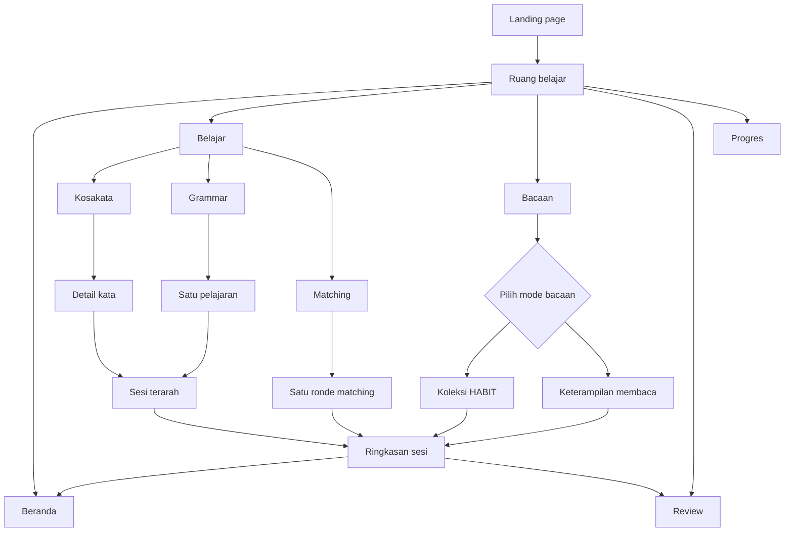

# PRD — SinauuEnglish UI/UX Redesign & Information Architecture

> **Status:** Draft for implementation planning  
> **Owner:** Riiddev  
> **Scope:** Workspace navigation, page hierarchy, layout density, responsive behaviour, and regression criteria.  
> **Constraint:** Preserve the existing frontend, learning data, mastery rules, and local progress.

## 1. Executive summary

SinauuEnglish has useful learning modes, but the workspace currently places too many summaries, panels, and learning areas in the same visual flow. The overview combines progress, daily goals, suggestions, and mode cards; the Reading Comprehension view places the HABIT reading collection and the 12 reading-skill lessons on one page. The result is a UI that feels stacked and visually noisy.

This release should reorganize the existing product—not add more features. Every screen needs a clear purpose, a clear hierarchy, and one obvious next action.

**Product rule: one page, one primary task, one clear next action.**

## 2. Current-state findings

Based on the current repository:

- `index.html` is the public landing page and leads to `/belajar.html`.
- `belajar.html` contains the workspace views: overview, vocabulary, grammar, study, matching, reading, review, and progress.
- The overview currently mixes mode cards, suggested/recent actions, daily goal, and multiple progress summaries.
- The Reading view includes both the HABIT full-passage library and the 12-skill curriculum in the same long page.
- Vocabulary, grammar, matching, reading, review, progress, backup/export, and local storage are already implemented. The redesign must organize these capabilities, not silently remove them.
- The app is frontend-only with local learning records; no backend or paid service is required for this release.

The primary problem is **information architecture and visual hierarchy**, not a lack of features.

## 3. Goals and non-goals

### Goals
1. Reduce the workspace to five top-level destinations.
2. Make each screen's primary task obvious without scanning many cards.
3. Separate the HABIT reading collection from reading-skill lessons.
4. Keep study sessions focused on one step at a time.
5. Remove repeated dashboard metrics and unnecessary nested cards.
6. Retain the warm editorial identity (paper, sage, lilac), but improve spacing, typography, and visual rhythm.
7. Preserve local progress, the mastery gate, content status labels, and backup/restore.
8. Add testable acceptance criteria before the UI is considered finished.

### Non-goals
- No login, backend database, sync service, paid API, or new hosting dependency.
- No bulk rewrite of vocabulary, grammar, or the HABIT content.
- No new learning modes, AI tutor, gamification system, or animation-heavy dashboard.
- No forced framework/router migration just to change the layout.
- No marking draft vocabulary as human-reviewed.
- No deleting existing capabilities; secondary actions may move into tabs, drawers, or collapsible sections.

## 4. Target user and jobs to be done

**Primary user:** an Indonesian learner studying English independently, often in a short session and sometimes on a mobile browser.

The product should help them:
- open the workspace and immediately know what to do next;
- find a word, understand it in context, and start practice;
- choose either a full reading passage or a reading-skill exercise without seeing both entire collections at once;
- finish one session and understand the result;
- find words due for review;
- view progress or export study records only when they need to.

## 5. Proposed information architecture

### Top-level navigation

| Destination | Main purpose | Content |
|---|---|---|
| **Beranda** | Decide what to do next | Continue learning, one next action, compact summary |
| **Belajar** | Learn and practise language items | Kosakata, Grammar, Matching as sub-navigation |
| **Bacaan** | Improve reading comprehension | HABIT library OR reading-skill lessons, selected by tabs |
| **Review** | Retrieve previously learned items | Due/weak words, review queue, completion result |
| **Progres** | Understand progress | CEFR progress, activity history, backup/export |

Theme toggle and other utilities remain in the header or a clearly labelled data/settings area; they are not top-level destinations.

### IA map

### Navigation rules
- Only one destination is active/highlighted at a time.
- **Belajar** uses visible tabs for Kosakata / Grammar / Matching. Do not place three complete learning views vertically on one page.
- **Bacaan** uses a segmented switch for Koleksi HABIT / Keterampilan membaca. Only the selected mode is visible.
- Keep the main navigation stable between workspace views.
- On mobile, use a compact drawer or bottom navigation instead of wrapping desktop navigation into several rows.
- Preserve useful existing view IDs and data attributes where practical to reduce regression risk.

## 6. Page requirements

### 6.1 Landing page
**Job:** explain the learning approach and get the learner into the workspace.

Order: compact header → hero with one clear message and CTA → short explanation of the learn/retrieve/use approach → concise feature map → footer.

Rules:
- The landing page is not a second dashboard.
- One primary CTA per major section at most.
- Avoid repeating feature cards with equal visual weight.
- Motion supports comprehension and never delays the main action.
- Keep the existing editorial visual identity.

### 6.2 Beranda
**Job:** answer “What should I do next?”

Required order:
1. Short greeting/session context.
2. One primary action: “Lanjutkan belajar” when there is a resumable activity; otherwise “Mulai sesi pertama”.
3. One compact row with up to three indicators: due review, today's activity, and progress/mastery.
4. A small “Pilihan belajar” area linking to Kosakata, Grammar, and Matching.
5. Recent activity is optional and collapsed/secondary when it does not help the next action.

Remove/consolidate:
- Do not repeat mastery/due/activity numbers in multiple panels.
- Do not show a large progress ring and another set of identical metrics together.
- Do not show several recommendation cards if one strong next action exists.
- Daily goal remains editable but should not dominate the page.

Empty state: a short explanation of the first session and one CTA; no empty charts or zero-filled metric cards.

### 6.3 Belajar — Kosakata
**Job:** find a word and start meaningful practice.

Desktop: page heading → one toolbar with search and compact filters → results list + selected-word detail panel.

The selected-word panel shows the meaning, pronunciation if available, part of speech/level, one main example and translation, relevant usage note, and one primary “Latih kata ini” CTA. Less-frequent information (extra contexts, collocations, source details) goes inside a disclosure area.

Mobile: show search/results first; selecting a word opens a full-width detail screen/sheet with a back or close action. Do not stack a long list, its detail panel, and study forms into one long mobile page.

Content rules:
- Incomplete entries remain visibly “Materi belum siap”; practice cannot start for them.
- Preserve existing draft/provenance notices.
- Never leave the detail panel empty without loading/error/instruction state.

### 6.4 Belajar — Grammar
**Job:** learn one grammar topic in a predictable sequence.

Layout: page heading → compact topic selector/list → one selected lesson containing explanation, pattern, translated examples, common mistakes, checkpoint, and exercises.

Desktop can use a two-column topic-list/lesson layout. Mobile uses a topic picker and one lesson panel. Do not render several full lessons vertically. Keep topic completion status small and close to its topic.

### 6.5 Belajar — Matching
**Job:** complete one matching round.

Layout: short instruction and compact round summary → one matching board → feedback → “Ronde baru” or “Selesai” at the appropriate time.

Hide unrelated dashboard metrics while a round is active. Keep keyboard access and visible focus states.

### 6.6 Sesi belajar
**Job:** focus on one learning step.

Layout: current step (Recall → Context → Production) → one prompt and response area → one primary submit action. After submission, replace the form with its feedback and one Continue action. Finish with a compact result and one next step.

Acceptance rules:
- Only the current prompt/form OR its submitted feedback is active at a time.
- The submitted answer and explanation remain visible.
- Empty input, error, and retry states are clear and actionable.
- Respect `prefers-reduced-motion`.

### 6.7 Bacaan
**Job:** choose and complete one reading activity without facing two full content libraries at once.

At the top: page heading, one-line explanation, and a segmented switch:
- **Koleksi HABIT**
- **Keterampilan membaca**

Only one mode is rendered/visible at a time; switching mode must not append another long collection beneath the current one.

**Koleksi HABIT**
- Search + one category filter row.
- Compact passage rows/cards, progressively loaded.
- Choosing a passage opens a focused reader and its three comprehension questions.
- Show full paragraphs, paragraph numbers, estimated time, and source page when known.
- Feedback points to evidence and paragraph number.
- Keep completion status close to the selected passage, not duplicated in several page-level metric cards.

**Keterampilan membaca**
- Show all 12 skills in a compact index/list.
- Open one skill lesson at a time with its definition, strategy, text/question, answer feedback, and evidence.
- Category controls filter the list without adding another content stack.

On mobile, opening a passage or skill transitions into a focused detail screen with a clear back action. Do not repeat the entire library below the article/quiz.

### 6.8 Review
**Job:** practise due/weak words with minimum friction.

Show page heading and count of items due → one compact queue → focused review session → result and next action.

Empty state: “Belum ada kata yang perlu di-review sekarang” and a route back to learning. Avoid a large empty queue or redundant zero-stat cards.

### 6.9 Progres
**Job:** understand improvement and decide where to focus next.

Order: compact summary row (up to three metrics) → progress by CEFR level → grammar/topic progress → collapsible activity history → clearly separated “Data belajar” area for backup export/import.

Do not duplicate all Beranda metrics. Do not claim a word is mastered unless the existing mastery engine marks it mastered. Warn before an import replaces local progress and preserve existing validation.

## 7. Shared visual system

### Design direction
Retain SinauuEnglish's warm paper/sage/lilac editorial personality. The workspace should feel like a thoughtfully arranged study desk, not a generic SaaS dashboard.

### Layout rules
- One page title per active view.
- One primary action per screen; secondary actions use quieter styling.
- Main content max-width target: 68–76rem on wide screens. Reading text itself stays narrower for comfortable line lengths.
- Use a consistent spacing scale: 8, 12, 16, 24, 32, 48 px.
- Use whitespace and dividers for hierarchy before adding another border/background.
- Cards group meaningful sections; avoid wrapping each small component in a card inside another card.
- Use compact rows for navigable lists; reserve large cards for a small number of important choices.
- Reading text target: 60–75 characters per line on desktop with generous line height.
- Avoid repeated oversized stats, gradients, badges, or decorative motion that compete with content.

### Responsive rules

| Width | Behaviour |
|---|---|
| ≥ 1200 px | Stable side navigation; split list/detail only where it improves selection |
| 768–1199 px | Compact navigation; hide/de-emphasize secondary panels |
| < 768 px | Drawer/bottom navigation; one content column; detail screens with back/close action; no horizontal overflow |

### Accessibility
- Semantic heading hierarchy and visible form labels.
- Keyboard-accessible navigation, tabs, dialogs, list selection, quiz options, review, and backup controls.
- Visible focus rings and sufficient contrast.
- Status never relies on colour alone.
- Honour `prefers-reduced-motion`.
- Announce meaningful dynamic status without disruptive focus jumps.

## 8. Prioritized requirements

| ID | Priority | Requirement | Acceptance criteria |
|---|---|---|---|
| IA-01 | P0 | Five top-level destinations | Beranda, Belajar, Bacaan, Review, Progres are clear; current features reachable within two deliberate navigation actions |
| IA-02 | P0 | Belajar sub-navigation | Kosakata/Grammar/Matching switch within Belajar; only the selected view is visible |
| IA-03 | P0 | Separate reading modes | HABIT and reading skills are mutually exclusive views/tabs, not one stacked page |
| UX-01 | P0 | Clear page hierarchy | A learner can identify the title, main task, and primary action without scanning competing cards |
| UX-02 | P0 | Remove duplicate metrics | Due/activity/mastery metrics are not repeated in multiple overview panels |
| UX-03 | P0 | Focused study session | Only current prompt/form or submitted feedback is active at a time |
| UX-04 | P0 | Complete states | Every major asynchronous/interactive view has applicable loading, error, empty, and completed states |
| DATA-01 | P0 | Preserve the engine and local data | Existing progress, mastery rules, storage fallback, and backup/restore remain functional |
| DATA-02 | P0 | Preserve content gates | Draft statuses remain honest; incomplete words cannot start a study session |
| QA-01 | P0 | Browser regression coverage | Tests cover navigation, a word session, reading-mode switch, HABIT quiz, review/progress access, and local persistence |
| QA-02 | P0 | Content/build checks | Content audit and production build pass; required data/script mirrors stay synchronized |
| UX-05 | P1 | Responsive detail views | No overflow at 360 px; mobile word/reading details have back/close controls |
| A11Y-01 | P1 | Keyboard and motion | Core flows work by keyboard, focus is visible, reduced-motion is respected |
| VIS-01 | P1 | Shared tokens | Spacing, type hierarchy, button states, and content width are consistent across views |

## 9. Key user flows

### First-time learner
Landing → Beranda → “Mulai sesi pertama” → Belajar → choose Kosakata/Grammar/Matching → focused session → feedback/result → return to Beranda or continue to Review when relevant.

### Returning learner
Workspace → Beranda → “Lanjutkan belajar” OR “Review due” → focused activity → result/next action → Progres only when a broader report is needed.

### Reading learner
Workspace → Bacaan → choose Koleksi HABIT OR Keterampilan membaca → search/select one item → read → answer → inspect evidence → return to the selected mode's list with progress preserved.

## 10. Delivery plan

### Phase 0 — Baseline and safety
- Capture current UI at desktop, tablet, and mobile sizes.
- Confirm view IDs, storage keys, mastery gate, and backup/restore behaviour.
- Work in a branch; do not replace production until acceptance criteria pass.

### Phase 1 — IA and de-cluttering (P0)
- Restructure navigation and make Belajar sub-navigation explicit.
- Rebuild Beranda around one next action and compact metrics.
- Separate HABIT library and reading skills with mutually exclusive tabs.
- Standardize page headings, toolbar placement, section spacing, and empty states.
- Keep the current content and study logic.

### Phase 2 — Focused learning screens (P0/P1)
- Simplify vocabulary and grammar list/detail patterns.
- Make sessions one-step-at-a-time.
- Normalize Matching, Review, and Progres layouts.
- Add mobile detail/drawer patterns and responsive checks.

### Phase 3 — Validate and release
- Run content audit and production build.
- Run Playwright flows at desktop and mobile widths.
- Visually review Beranda, Kosakata, Grammar, Bacaan list/detail, session, Review, and Progres.
- Merge only when no critical interaction regression or horizontal overflow remains.
- Confirm Vercel production readiness and inspect runtime errors.

## 11. Success measures and release gates

Do not invent adoption metrics before reliable product analytics exist. Use explicit release checks first.

Required:
- All P0 acceptance criteria pass.
- Content audit and production build pass.
- Browser tests cover navigation, a complete word session, reading-mode switching, HABIT quiz feedback, progress/review access, and local persistence.
- No uncaught browser errors in tested flows.
- No horizontal overflow at 360, 768, 1024, and 1440 px.
- Visually inspect Beranda, Kosakata, Grammar, Bacaan, and sesi belajar on desktop and mobile.
- Existing local progress remains after navigation/reload.
- No regression in keyboard access, visible focus, or reduced-motion support.

Usability check: ask 3–5 learners to (1) find a word and practise it, (2) open a HABIT passage and answer a question, (3) find Review, and (4) find Progres and export data. Note where they hesitate, then make a focused follow-up pass instead of adding features.

## 12. Risks and guardrails

| Risk | Mitigation |
|---|---|
| View changes break event bindings | Keep existing IDs/data attributes where possible and add tests before changing selectors |
| Local progress is lost | Preserve storage keys/migrations; test reload and backup/restore |
| Redesign becomes feature expansion | Keep this release to layout, navigation, and states |
| Mobile remains crowded | Test mobile early, not after desktop polish |
| Draft vocabulary appears verified | Keep provenance/draft status and practice-readiness gates |
| PRD becomes too heavy to implement | Deliver P0 first; track P1 in follow-up issues |

### Decisions
- No backend or paid dependency.
- No forced framework migration.
- No bulk content rewrite in this release.
- Motion and decoration must support hierarchy, not add layers.

## 13. Definition of done

The redesign is complete only when:
- The navigation and page structure match Section 5.
- Every P0 requirement has a passing acceptance test.
- All current learning capabilities remain reachable.
- The new layout is visually checked at desktop and mobile widths.
- Content/build audits pass and no critical browser errors remain in test flows.
- Production is READY and its key user journeys work.
- Draft content is still labelled honestly.

## 14. PRD method references

Ngoding Pake AI publicly describes **Bikin Plan** as a way to turn an idea into a PRD, feature specification, and tasks for AI coding agents. Its public landing page was accessible, but I could not operate/export from its interactive generator through this browsing interface. This document is therefore **not represented as an export from Ngoding Pake AI**; it uses alternative public PRD guidance instead.

- [Ngoding Pake AI](https://www.ngodingpakeai.com/) — product description of Bikin Plan.
- [Figma — How to create a PRD](https://www.figma.com/resource-library/product-requirements-document/) — goals, users, feature scope, flows, release criteria, risks, and metrics.
- [Productboard — Product Requirements Document](https://www.productboard.com/glossary/product-requirements-document/) — outcome, user context, scope items, and visual flow artefacts.
- [Atlassian — Requirements documentation](https://www.atlassian.com/agile/product-management/requirements) — shared understanding, user needs, and requirements that guide delivery.

This is a product-level plan. The next step is to design a small visual preview from this IA, review it, and only then change production UI.
